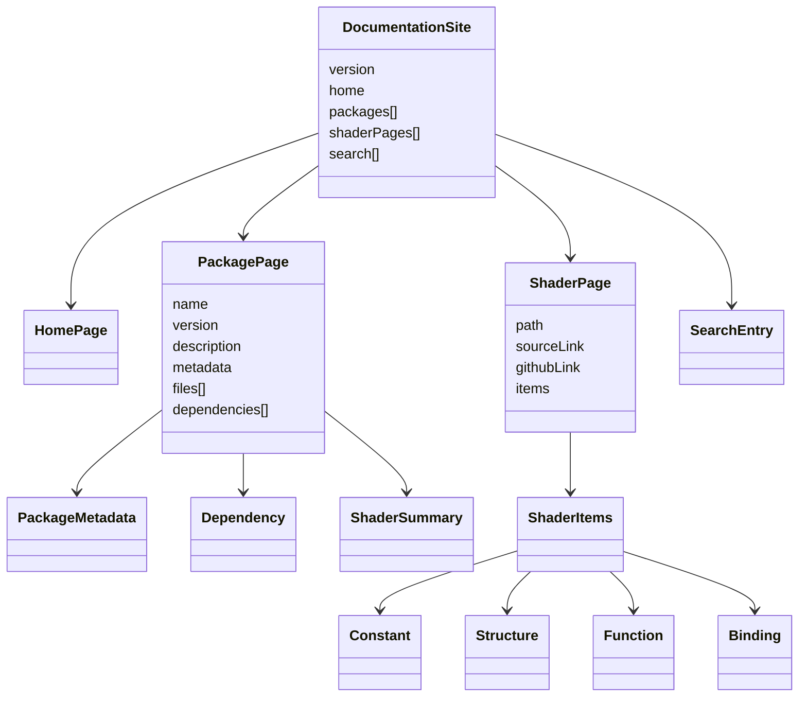
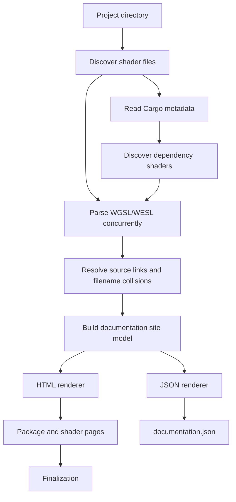

# Shader Explorer guide

## CLI

```text
wgsl-docs generate [flags]
  --project PATH       project directory (default: .)
  --output PATH        output directory (default: ./shader-docs)
  --format FORMAT      documentation format: html or json (default: html)
  --version VERSION    documentation version label (default: project)
  --exclude PATTERN    exclude a directory or pattern (repeatable)
  --no-deps            disable Cargo dependency shader discovery
  --offline            use Cargo metadata without network access
  --source-url URL     base URL for source links
  --source-ref REF     source branch, tag, or commit for source links
  --site-url URL       public origin for canonical URLs and sitemap
  --issue-url URL      URL for requesting documentation for a crate
  --skip-catalogue     render release pages without catalogue finalization
  --quiet, -q          suppress progress and informational logs
```

The catalogue uses two phases. Release passes write package and shader pages;
the finalization pass merges the catalogue and writes shared assets, manifests,
the homepage, social cards, `robots.txt`, and the sitemap:

```bash
wgsl-docs finalize --output ./dist --site-url https://shaders.example.com
```

`just generate-all` runs this workflow automatically. `just generate-json`
requires a concrete project path and writes `documentation.json` instead of
HTML pages.

Parser models are cached outside `dist` using source-content and link-settings
digests, so repeated matrix runs reuse unchanged shader parses safely. Use
`--quiet` for CI or other non-interactive builds:

```bash
go run ./cmd/wgsl-docs-build --quiet clone
go run ./cmd/wgsl-docs-build --quiet generate
```

## Search and SEO

Generated sites provide global search across packages, versions, shader files,
declarations, comments, types, descriptions, and shader-stage attributes.
Multiple terms use AND semantics. Queries can include `@vertex`, `@fragment`,
or `@compute` filters. Press `S` or `/` to focus search and `Escape` to leave
it; the query is preserved in the URL.

The generator writes per-release search indexes plus merged
`public/search-info-all.json` and a hashed `public/search-index-manifest.json`.
The browser stores the global index in IndexedDB and validates the manifest
hash before downloading it again. If IndexedDB or FlexSearch is unavailable,
search falls back to in-memory data and linear matching. The UI displays at
most 50 results.

Declarations are grouped across versions only when package, source file, name,
and type all match. Different packages and files remain separate. Grouped
results include a newest-first version selector, and the declaration link
points to the newest available version by default.

Search results are ranked by exact and prefix name matches, filename, package,
type, and description.

HTML pages include canonical URLs, Open Graph and Twitter metadata, JSON-LD,
`robots.txt`, and—when `site_url` is configured—an absolute `sitemap.xml`.
Set `site_url` in `wgsl-docs.toml` or use the `SITE_URL` environment variable.
Social preview cards are generated under `public/og/`: one site card and one
package/version card reused by that package's shader pages. PNG cards use
`resvg` when available, with an SVG fallback otherwise.

## Used-by relationships

Shader pages show which other shaders use an exported declaration through an
explicit shader import. During generation, imports become usage edges, which
are attached to matching constants, bindings, structures, and functions. The
page renders deduplicated, sorted links in a collapsed “Used by” section.

This tracks recognized imports only; it does not infer arbitrary textual
references or function calls.

## Generation pipeline

Each run discovers `.wgsl` and `.wesl` files, optionally discovers dependency
shaders through Cargo, parses files concurrently, resolves source links and
filename collisions, builds a renderer-neutral documentation model, and then
writes HTML or JSON from that model.

Parser models are cached outside `dist` using source-content and link-settings
digests, so repeated catalogue runs can reuse unchanged parses safely.

The renderer consumes a shared model rather than parser-specific structures.
The HTML and JSON renderers both receive package metadata, dependencies, shader
pages, declaration items, links, and search entries from that model.





## Add a library to the catalogue

Add a `[[sources]]` entry to `shader-sources.toml`:

```toml
[[sources]]
name = "bevy_hanabi"
repo = "https://github.com/djeedai/bevy_hanabi.git"
root = "sources/hanabi"
ref_pattern = "v{version}"
versions = ["0.15.0", "0.16.0", "0.17.0", "0.18.0", "0.19.0"]
```

For unusual release tags, override individual versions with
`[[sources.releases]]`, then run:

```bash
just clone-all
just generate-all
```

Workspace repositories can use `package_aliases` to rename a Cargo package in
the generated catalogue without changing dependency resolution or source links.

For example:

```toml
package_aliases = { example = "bevy_enoki_example" }
```

The repository root is not itself a package for JSON generation; use a concrete
source checkout such as `./sources/bevy/0.19.1`. The bundled Bevy catalogue
uses the same matrix for cloning sources and writing `dist/`. `just deploy-prod`
deploys existing output without regenerating it.

The source matrix is defined in `shader-sources.toml`. You can use another
matrix with:

```bash
go run ./cmd/wgsl-docs-build --config path/to/matrix.toml clone
go run ./cmd/wgsl-docs-build --config path/to/matrix.toml generate
```

If you want a library added without editing the configuration, open an issue
with its repository and release information.
